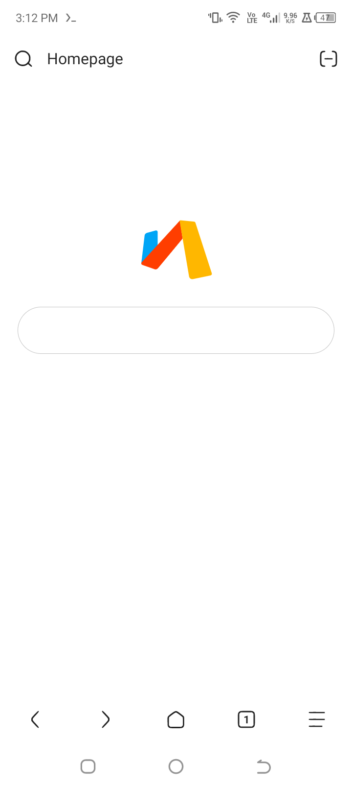
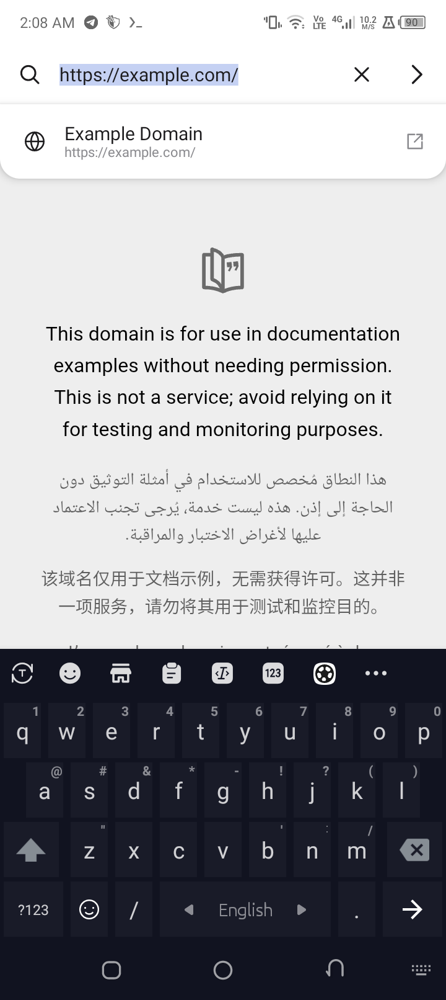
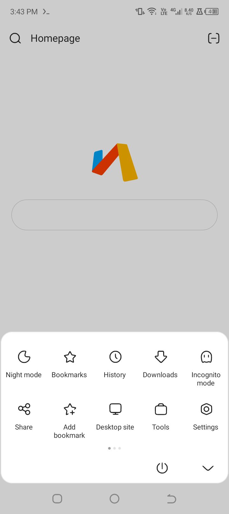
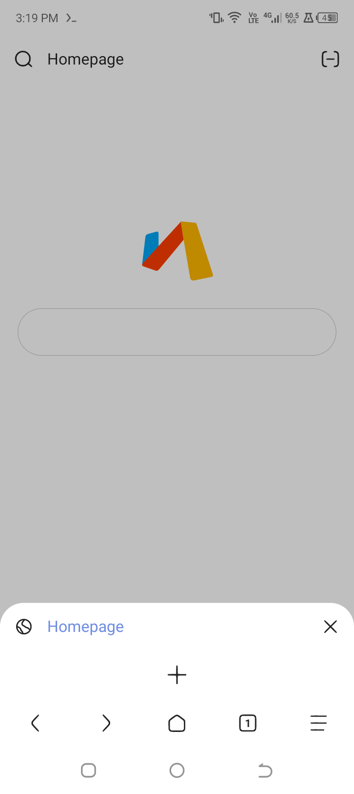
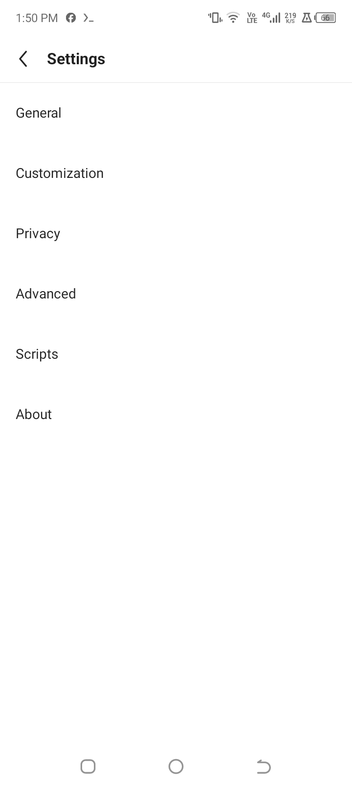
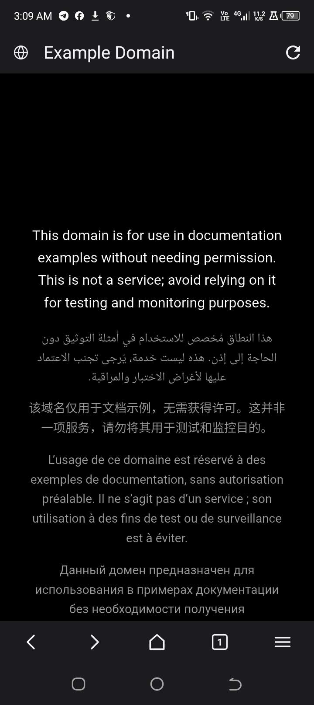
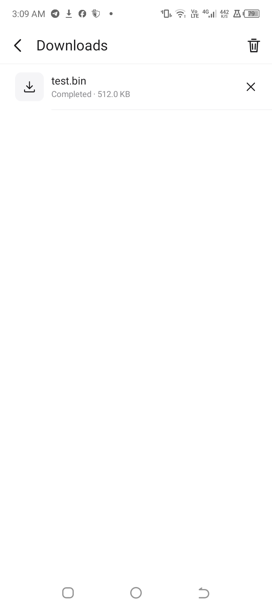
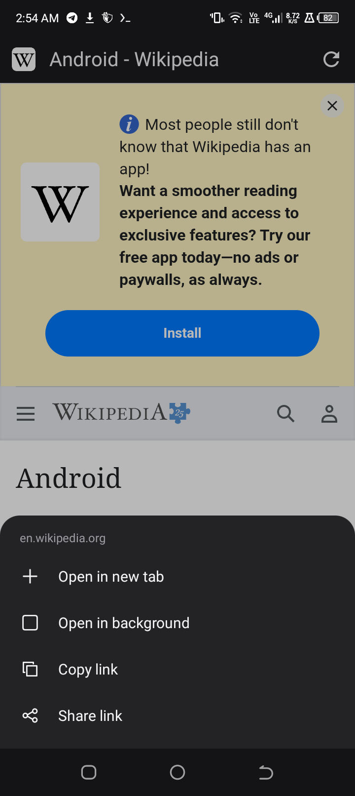

# Jump

Jump is a fast, lightweight Android browser built from scratch in Kotlin. It is a
clean-room implementation of the familiar Via browsing experience: a quiet
one-line title bar, a floating homepage search field, a five-slot bottom toolbar,
an inline blueprint address bar, a compact tab popup, and a paged action sheet.

Jump is not affiliated with Via. No Via source code, binary, or artwork is
included in this repository. The application is an independent implementation
with its own package (`com.jump.browser`), engine wrapper, data layer, and UI.

## Highlights

- **Real browser engine.** Android WebView backs every tab, with navigation
  history, favicons, download interception, file uploads, JavaScript dialogs,
  full-screen video, and site permission handling.
- **Tab management.** Multiple tabs, restoration across process death, private
  tabs, a compact bottom-anchored tab popup, and per-tab desktop mode.
- **Homepage.** Jump's own three-ribbon mark, search field, and bookmark
  shortcuts. The homepage is native Compose, not generated HTML.
- **Blueprint address bar.** Inline editing with automatic selection, URL/search
  detection, local and remote suggestions, clear/go actions, and an expand
  affordance.
- **Paged menu.** The two-row, five-column action sheet with animated page
  transitions, page dots, and the familiar exit affordance.
- **Library.** Bookmarks with icons, editable entries and a search field;
  grouped, searchable history; and a download manager built on Android's
  DownloadManager.
- **Reader mode.** Article extraction with a typography-focused reader surface.
- **Find in page.** Live match count with previous/next navigation.
- **QR scanner.** CameraX preview with ZXing decoding, plus a clipboard
  fallback.
- **Privacy controls.** Built-in network and cosmetic ad blocking, optional
  third-party cookie blocking, Do Not Track injection, JavaScript and image
  controls, and one-tap browsing-data clearing.
- **Desktop mode, share, copy, save page, print, view source, translate, and
  home-screen shortcuts.**

## Screens

| | |
|---|---|
|  |  |
| **Homepage** with bookmark shortcut. | **Blueprint address bar** with live suggestions. |
|  |  |
| **Action sheet** with paged tools. | **Compact tab popup** anchored to the toolbar. |
|  |  |
| **Settings** with granular controls. | **Night mode** across chrome and page content. |
|  |  |
| **Download manager.** | **Long-press link and image actions.** |

More captures: [page](docs/screenshots/page.png), [reader mode](docs/screenshots/reader.png),
[bookmarks](docs/screenshots/bookmarks.png).

## Architecture

Jump separates the browser engine from the interface:

```
UI (Compose)  →  BrowserController  →  WebView sessions
                     ↓
                Repositories (bookmarks, history, settings, downloads, tabs)
                     ↓
                AppContainer (application-scoped)
```

See [ARCHITECTURE.md](ARCHITECTURE.md) for the full design, state flow, and
extension points.

## Build

Requirements: Android SDK 37.2, build tools 36.0.0, JDK 21, Gradle 9.8. The
recommended on-device toolchain is TAD inside Termux.

```bash
tad doctor
tad build debug
tad install
```

Debug builds are written to `app/build/outputs/apk/debug/app-debug.apk`.
Minified release builds are written to `app/build/outputs/apk/release/app-release.apk`.

A signed, installable release is included at `dist/Jump-1.0.0.apk` with checksums
in `dist/SHA256SUMS.txt`. It is signed with the local debug key so it can be
sideloaded; use a private release key before publishing to a store.

## Project layout

```
app/src/main/java/com/jump/browser/
  MainActivity.kt          activity, intents, file chooser, configuration
  JumpApp.kt               application and AppContainer
  browser/                 WebView engine, URL logic, ad blocking
  data/                    models, repositories, persistence
  ui/                      Compose browser shell, screens, icons, theme
app/src/test/              unit tests for URL handling and models
```

## Status

Core browsing, tabs, navigation, libraries, downloads, settings, reader mode,
find in page, QR scanning, ad blocking, and the full chrome are implemented.
The signed release is 2.2 MB.

Known gaps: incognito tabs suppress history without isolating cookies because
Android WebView profiles are only available on newer WebView providers.
Bookmarks are flat rather than folder-based, and saved-page management is
limited to the save action and a confirmation toast. These are deliberate
extension points, not hidden behavior.

## License

MIT. See [LICENSE](LICENSE). The name "Jump", the Jump mark, and all source
code in this repository are original to this project.
