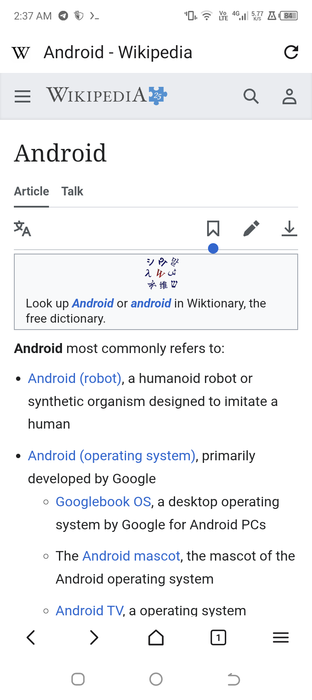

# Jump

A fast, lightweight Android browser in Kotlin. Jump is a clean-room
implementation of the familiar Via browsing experience — a quiet one-line
title bar, a floating homepage search field, a five-slot bottom toolbar, an
inline address editor and a compact paged action sheet — on top of the Android
WebView engine.

Jump is an independent project with its own package (`com.jump.browser`),
engine wrapper, data layer and UI. It is not affiliated with Via, and contains
no Via source, binaries or artwork.

## Screens

| Homepage | Browsing | Menu | Tabs |
|---|---|---|---|
|  |  |  |  |

## Features

- **Browsing** — tabs with process-death restore, private tabs, per-tab
  desktop mode, find in page, translate, print, view source, full-screen
  video.
- **Homepage** — native Compose homepage with a custom logo and background,
  colored shortcut tiles and pull-to-search.
- **Address bar** — inline and full-screen editing, URL/search detection,
  local and remote suggestions.
- **Menu** — paged action sheet with animated page transitions, page dots and
  a compact bottom-anchored tab popup.
- **Library** — bookmarks with icons, grouped searchable history, a download
  manager over Android's DownloadManager, and saved web archives.
- **Content tools** — reader mode, read-aloud, QR scanner, resource sniffer
  and network log.
- **Privacy** — network and cosmetic ad blocking, third-party cookie
  blocking, Do Not Track, per-site JavaScript/image controls, one-tap data
  clearing.
- **Customization** — toolbar layouts, user agent, night mode, reorderable
  menu.

## Architecture

```
Compose UI  →  BrowserController  →  WebView sessions
                     ↓
        Repositories (JSON over SharedPreferences)
                     ↓
               AppContainer
```

Layers, state flow and extension points are documented in
[ARCHITECTURE.md](ARCHITECTURE.md).

## Build

Toolchain: Android SDK 37.2, build tools 36.0.0, JDK 21, Gradle 9.8.

```bash
tad build debug
tad install
```

Debug artifacts land in `app/build/outputs/apk/debug/`; minified release
builds in `app/build/outputs/apk/release/`. Pushes to `master` run unit tests
in CI; a `vX.Y.Z` tag builds a signed APK with a SHA-256 checksum and
publishes it as a GitHub Release.

## Versioning

[Semantic Versioning](https://semver.org). `version.properties` is the single
source for `versionName` and `versionCode`; every release adds a matching
`## [x.y.z]` section to [CHANGELOG.md](CHANGELOG.md), and CI fails on any
disagreement between the two.

## Project layout

```
app/src/main/java/com/jump/browser/
  MainActivity.kt   activity, intents, file chooser, configuration
  JumpApp.kt        application and AppContainer
  browser/          WebView engine, URL logic, ad blocking
  data/             models, repositories, persistence
  ui/               Compose browser shell, screens, icons, theme
app/src/test/       unit tests for URL handling and models
```

## Status

Core browsing, tabs, navigation, libraries, downloads, settings, reader mode,
find in page, QR scanning and ad blocking are implemented and released. Known
gaps: private tabs suppress history but do not isolate cookies on older
WebView providers, bookmarks are flat rather than folder-based, and sync,
passwords and scripts are not implemented. The resource sniffer and network
log record traffic only while their panel is open; response sizes are
unavailable because WebView does not expose them.

## License

MIT. See [LICENSE](LICENSE). The name "Jump", the Jump mark and all source
code are original to this project.
