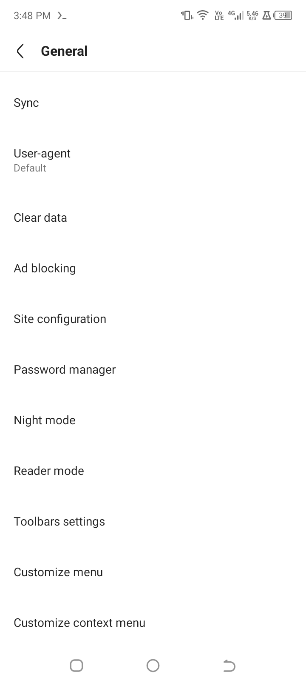
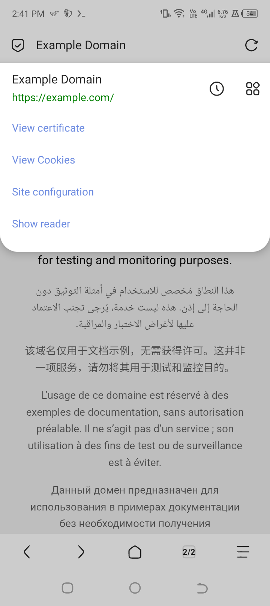

# Jump

Jump is a fast, lightweight Android browser built from scratch in Kotlin. It is a
clean-room implementation of the familiar Via browsing experience: a quiet
one-line title bar, a floating homepage search field, a five-slot bottom toolbar,
an inline blueprint address bar, a compact tab popup, and a paged action sheet.

Jump is not affiliated with Via. No Via source code, binary, or artwork is
included in this repository. The application is an independent implementation
with its own package (`com.jump.browser`), engine wrapper, data layer, and UI.

## Highlights

- **Real browser engine.** Android WebView backs every tab, with navigation
  history, favicons, download interception, file uploads, JavaScript dialogs,
  full-screen video, and site permission handling.
- **Tab management.** Multiple tabs, restoration across process death, private
  tabs, a compact bottom-anchored tab popup, and per-tab desktop mode.
- **Homepage.** Jump's own three-ribbon mark, search field, and bookmark
  shortcuts. The homepage is native Compose, not generated HTML.
- **Blueprint address bar.** Inline editing with automatic selection, URL/search
  detection, local and remote suggestions, clear/go actions, and a true
  full-screen editing mode that keeps the keyboard attached.
- **Paged menu.** The two-row, five-column action sheet with animated page
  transitions, page dots, and the familiar exit affordance.
- **Library.** Bookmarks with icons, editable entries and a search field;
  grouped, searchable history; and a download manager built on Android's
  DownloadManager.
- **Reader mode.** Article extraction with a typography-focused reader surface
  inside the live page area, so the title bar and bottom toolbar stay present.
- **Animated settings navigation.** Settings pages enter from the right while
  the outgoing page moves left, and can be dragged back from left to right with
  the page tracking the finger. Dialogs use the same horizontal dismiss gesture.
- **Reference toast surface.** Short messages use Jump's own bottom pill instead
  of the platform toast, with the reference geometry, duration and action slot.
- **Find in page.** Live match count with previous/next navigation.
- **Resource sniffer and network log.** Live MIME-classified request capture
  while the panel is open, with open/download/copy actions and request timing.
- **Read aloud.** Article-aware text-to-speech using the platform engine, with
  a second activation stopping playback.
- **Saved pages.** Web archives are listed, reopened and deleted in-app.
- **Customization.** Custom homepage logo and background with opacity, optional
  homepage search bar and colored tiles, a separate Night mode, user-agent
  choice, reorderable menu, and top/bottom/slim toolbar layouts.
- **QR scanner.** CameraX preview with ZXing decoding, plus a clipboard
  fallback.
- **Privacy controls.** Built-in network and cosmetic ad blocking, optional
  third-party cookie blocking, Do Not Track injection, JavaScript and image
  controls, and one-tap browsing-data clearing.
- **Desktop mode, share, copy, save page, print, view source, translate, and
  home-screen shortcuts.**
- **Reference feedback language.** Interactive chrome controls, menu cells,
  list rows and toolbar slots use the reference `#30808080` ripple. Scrims and
  backdrops never ripple, and dialog buttons keep their ripple.

## Screens

| | |
|---|---|
|  |  |
| **Homepage** with the reference geometry and logo. | **Address bar** with the inline editor, search placeholder and page scrim. |
|  |  |
| **Action sheet** with paged tools. | **Compact tab popup** anchored to the toolbar. |
|  |  |
| **Settings categories.** | **General settings** with value subtitles. |
|  |  |
| **Page chrome** with security state. | **Site info panel.** |
|  |  |
| **Download manager.** | **Long-press link and image actions.** |

More captures: [bookmarks and history](docs/screenshots/bookmarks.png),
[full-screen address](docs/screenshots/address-fullscreen.png),
[night mode](docs/screenshots/night-mode.png).

## Architecture

Jump separates the browser engine from the interface:

```
UI (Compose)  →  BrowserController  →  WebView sessions
                     ↓
                Repositories (bookmarks, history, settings, downloads, tabs)
                     ↓
                AppContainer (application-scoped)
```

See [ARCHITECTURE.md](ARCHITECTURE.md) for the full design, state flow, and
extension points.

## Build

Requirements: Android SDK 37.2, build tools 36.0.0, JDK 21, Gradle 9.8. The
recommended on-device toolchain is TAD inside Termux.

```bash
tad doctor
tad build debug
tad install
```

Debug builds are written to `app/build/outputs/apk/debug/app-debug.apk`.
Minified release builds are written to `app/build/outputs/apk/release/app-release.apk`.

A signed, installable release is included at `dist/Jump-1.0.0.apk` with checksums
in `dist/SHA256SUMS.txt`. Rebuild it with `tad build release` after source
changes. It is signed with the local debug key so it can be sideloaded; use a
private release key before publishing to a store. Development happens on the
`master` branch.

## Project layout

```
app/src/main/java/com/jump/browser/
  MainActivity.kt          activity, intents, file chooser, configuration
  JumpApp.kt               application and AppContainer
  browser/                 WebView engine, URL logic, ad blocking
  data/                    models, repositories, persistence
  ui/                      Compose browser shell, screens, icons, theme
app/src/test/              unit tests for URL handling and models
```

## Status

Core browsing, tabs, navigation, libraries, downloads, settings, reader mode,
find in page, QR scanning, ad blocking, and the full chrome are implemented.
The signed release is 2.2 MB.

Known gaps: incognito tabs suppress history without isolating cookies because
Android WebView profiles are only available on newer WebView providers.
Bookmarks are flat rather than folder-based, sync and the password manager are
not implemented, and scripts/AI panels are not available. Resource sniffing and
the network log only record traffic while their panel is open, and the network
log cannot show response sizes because WebView does not expose them.

## License

MIT. See [LICENSE](LICENSE). The name "Jump", the Jump mark, and all source
code in this repository are original to this project.
